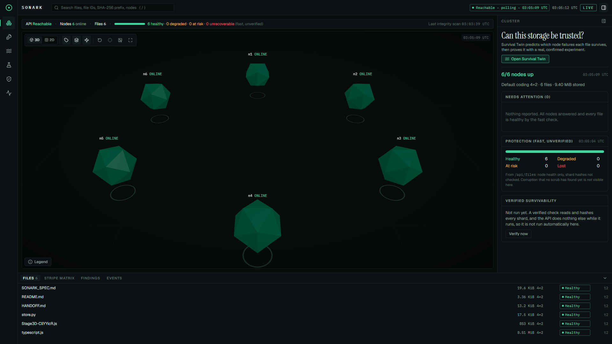
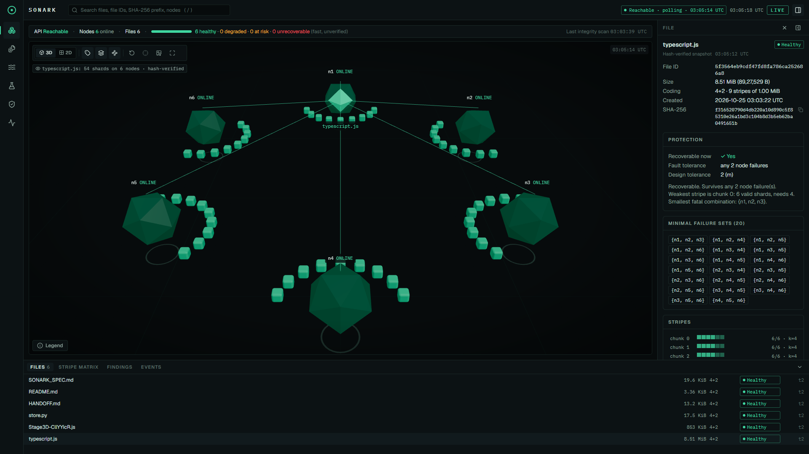
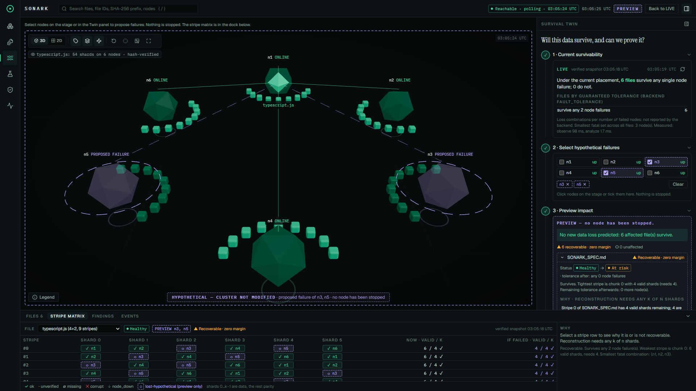
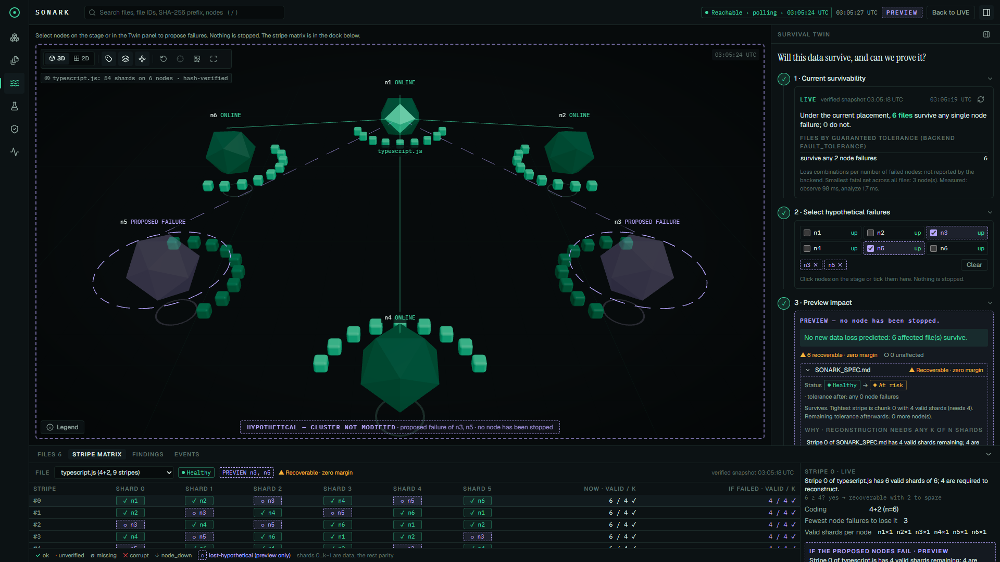
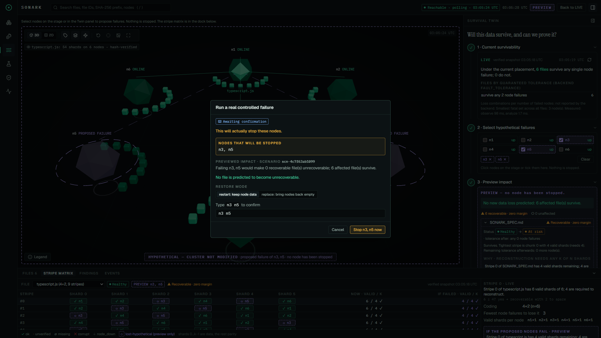
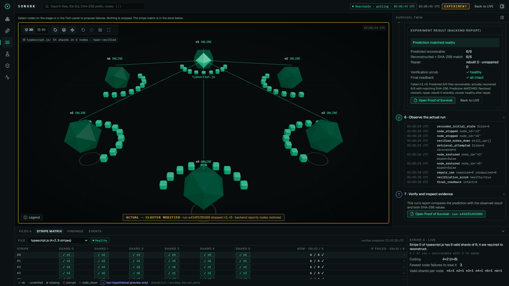
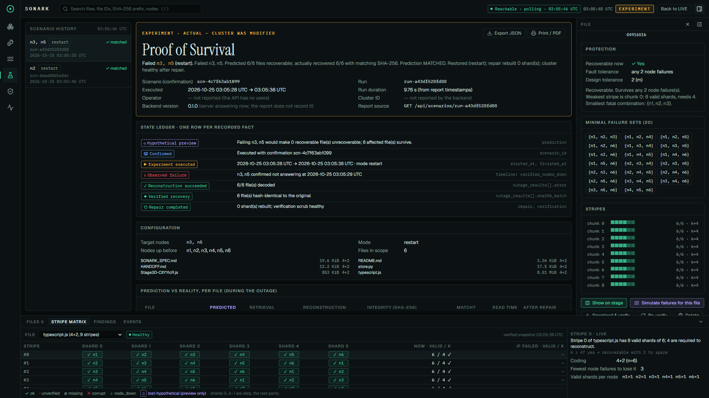
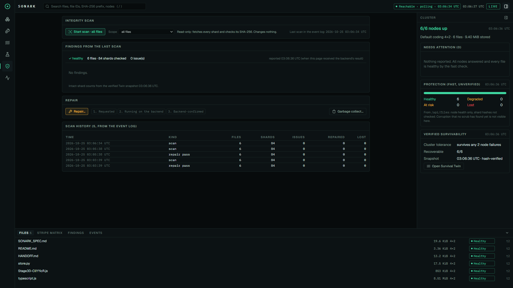

# SONARK

**Predict. Break. Prove.** SONARK is a self-healing distributed storage system with a
survivability workstation on top. It stores files as Reed–Solomon erasure-coded shards
spread across independent storage nodes. It predicts which node failures each file can
survive, then proves the prediction by stopping real nodes, reading every file back, and
checking SHA-256 hashes.

## What it does

- **Erasure-coded storage.** Files are split into stripes and encoded with
  Reed–Solomon k+m (default 4+2). The shards are placed on separate node processes, and
  any k valid shards rebuild a stripe.
- **Integrity checks.** SHA-256 is checked per shard, per chunk and per whole file.
  Scrub finds missing or corrupt shards, and repair rebuilds them from the surviving ones.
- **Survival Twin.** It analyses the actual shard placement:
  - which failure combinations each file survives;
  - the minimal sets of nodes whose loss destroys it;
  - per-stripe explanations ("valid shards vs. k required").
- **Previews and experiments.** A preview of a hypothetical failure never touches the
  cluster. A controlled experiment needs typed confirmation; it really stops the nodes,
  verifies recovery, restores the nodes and repairs.
- **Proof of Survival.** Evidence from every run's stored report: prediction against
  outcome, original and recovered hashes, a recovery timeline, and JSON or PDF export.
  Values the backend does not record are shown as "not reported", never invented.

## Screenshots

Captured from the running app on a local 6-node, 4+2 demo cluster. Every value shown comes
from the backend, and the experiments are real controlled failures.



| | |
|---|---|
|  |  |
| **File topology.** Where a file's 54 shards live, with its fault tolerance and minimal failure sets. | **Survival Twin preview.** A hypothetical failure of n3 and n5, predicted without touching the cluster. |
|  |  |
| **Stripe matrix.** Per-stripe valid shards against the k required, now and under the preview. | **Confirmation.** A real experiment runs only after the node names are typed. |
|  |  |
| **Experiment result.** Prediction against reality: files rebuilt, SHA-256 matched, nodes restored. | **Proof of Survival.** The run's recorded evidence, ledger and timeline, exportable as JSON or PDF. |
|  | |
| **Integrity scan.** A read-only scrub that hash-checks every shard, with scan and repair history. | |

## Repository layout

| Path | Contents |
|---|---|
| `sonark/` | Python backend (standard library only): codec, nodes, coordinator, Survival Twin, scenarios, JSON API, CLI |
| `tests/` | Backend test suite (`unittest`) |
| `frontend/` | React + TypeScript + Vite + Three.js workstation UI, with its tests |
| `SONARK_SPEC.md` | Architecture, metadata model, Twin math, API contract |
| `HANDOFF.md` | What exists, measured results, limitations |
| `frontend/README.md` | Frontend setup, checks and demo walkthrough |
| `frontend/API_MAPPING.md` | Every screen mapped to a real API endpoint |

## Quick start (Windows PowerShell)

Requirements: Python 3.11+ and Node.js 20+ (tested with Python 3.13 and Node 24).

```powershell
# Terminal 1: backend, from the repository root
python -m sonark init-local --dir sonark-cluster --nodes 6 --k 4 --m 2 --base-port 9300
python -m sonark --cluster sonark-cluster/cluster.json serve --manage --port 8800

# Terminal 2: frontend
cd frontend
npm install
npm run dev        # open http://localhost:5173 (the dev server forwards /api to port 8800)
```

`sonark-cluster/` holds local runtime data (shards, metadata database, logs) and is
ignored by Git. To reset:
1. Stop the server with Ctrl+C.
2. If it was killed hard, run `python -m sonark --cluster sonark-cluster/cluster.json stop-local`.
3. Delete the folder and run `init-local` again.

## Tests

```powershell
python -m unittest discover -s tests -t .      # backend suite
cd frontend
npm run typecheck
npm test
npm run build
```

Command-line demos that create and delete their own temporary clusters:
`python -m sonark demo` and `python -m sonark twin-demo`.

## Limitations

The API runs storage operations one at a time behind a single lock, so a running
experiment blocks other requests for its duration. On Windows, a request made while a node
is down costs about 0.5 s. `HANDOFF.md` and `SONARK_SPEC.md` (section 10) list all known
limitations.
